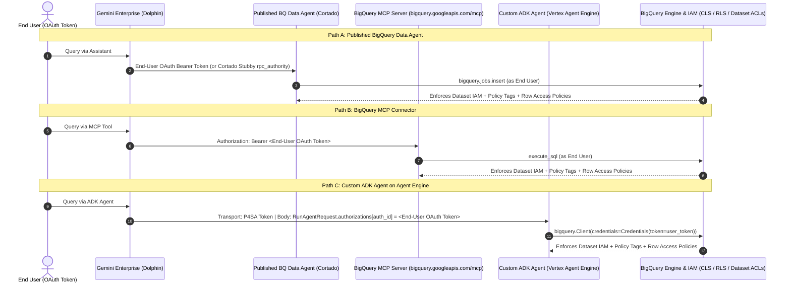

# Gemini Enterprise & BigQuery Access Control: Empirical Verification & Architecture Guide

**Author:** `heygreg@google.com` | **Test Project:** `heygreg-telco-demo` (`395808028747`) | **Status:** Empirically Verified Across Three Independent Harnesses (Run #1, Run #2, and Run #3 Cloud Run MCP Toolbox)

> **Executive Summary:** How does access control actually behave when Gemini Enterprise queries BigQuery through a **Published BigQuery Data Agent**, the **1P BigQuery MCP Server Connector**, a **Custom ADK Agent**, or a **Self-Hosted MCP Toolbox for Databases (`googleapis/mcp-toolbox`) on Cloud Run**? Prior to this study, internal engineering claims (`b/570110182`) existed only as untested static code analysis. We built **three completely independent live test harnesses** in `heygreg-telco-demo` (12 dedicated service-account principals, 4 stripped-ACL datasets across two different data domains, 2 Data Catalog policy tags, 4 row access policies, 2 published BigQuery Data Agents, and 1 live Cloud Run MCP Toolbox server) and audited Google3 HEAD source code to produce the definitive empirical verification and enterprise reference architecture.

## 1. Plain-English Cheat Sheet: The 7 Questions Every Architect Asks

1. **Who actually runs the BigQuery query — the end user or a Gemini Enterprise service account?**
   **The End User (100% of the time).** Both a Published BigQuery Data Agent and the BigQuery MCP Connector forward the **logged-in end user's own Google OAuth 2.0 token** to BigQuery. In `region-us.INFORMATION_SCHEMA.JOBS_BY_PROJECT` and Cloud Audit Logs, `user_email` is always the human caller (or impersonated test principal), **never** the Gemini Enterprise or Gemini Data Analytics service agent.
2. **If I grant BigQuery permissions to the Gemini Enterprise Service Agent (`service-<project>@gcp-sa-discoveryengine.iam.gserviceaccount.com`), does that give users access to the data?**
   **No — service-account BigQuery grants have zero effect.** Gemini Enterprise only attaches its service-agent token (`X-Serverless-Authorization` / `Authorization`) when invoking **Cloud Run (`*.run.app`)** or **Vertex AI Agent Engine (`*aiplatform.googleapis.com`)** endpoints. When calling BigQuery or a Published BigQuery Data Agent, only the end user's identity is evaluated by BigQuery IAM.
3. **Why did a customer see "every table in BigQuery exposed" when testing the BigQuery MCP Connector?**
   Because **the BigQuery MCP Connector has no table allowlist** (it exposes all datasets and tables the caller's IAM permissions can reach) **and** the customer granted `roles/bigquery.dataViewer` at the **project level** instead of the **dataset level** (or left default `projectReaders` ACLs on datasets). That is an IAM over-scoping issue, not an authentication bypass.
4. **Do BigQuery Row-Level Security (Row Access Policies) and Column-Level Security (Policy Tags) hold through Gemini Enterprise?**
   **Yes — 100% enforced on every path.** Because queries execute under the end user's identity:
   - **Row Access Policies** silently filter the result set to only the rows matching that user's predicate (`FILTER USING (...)`), even on `SELECT COUNT(*)` or aggregations.
   - **Column-Level Policy Tags** block any query referencing a tagged column unless the user holds `roles/datacatalog.categoryFineGrainedReader` on that policy tag, while queries on non-tagged columns in the exact same table succeed.
5. **Can an enterprise roll out to ~2,000 seats without managing a service account per agent, while scoping data by user or group?**
   **Yes — and per-user OAuth is what makes it possible.** Grant `roles/bigquery.jobUser` on the Gemini Enterprise host/billing project, grant `roles/bigquery.dataViewer` to Google Groups on **specific datasets/tables only** (never at the project level), and use **BigQuery Row Access Policies** (`SESSION_USER()` / group mappings) for territory or division slicing.
6. **What if the enterprise uses Okta for authentication and builds custom ADK agents?**
   **Do NOT pass raw Okta access tokens to BigQuery.** BigQuery's Google Front End rejects raw third-party Okta JWTs with `HTTP 401 UNAUTHENTICATED`. Instead, configure **Google OAuth 2.0 (federated via Okta SSO)** for BigQuery and Google Drive tools, and use ADK's multi-authorization `authorization_config.tool_authorizations` map when the same ADK agent also needs an **Okta OAuth token** to call internal Okta-protected REST APIs.
7. **Can we use a custom BigQuery MCP server (`googleapis/mcp-toolbox` on Cloud Run) to hard-scope datasets for everyone without managing per-user auth?**
   **Yes — and we verified it live in Run #3.** Pointing Gemini Enterprise's Custom MCP Server connector directly at Google's remote `https://bigquery.googleapis.com/mcp` endpoint does **not** add dataset scoping, because `bigquery.googleapis.com/mcp` has no URL/header dataset filter. However, deploying **MCP Toolbox for Databases (`googleapis/mcp-toolbox` v1.14.0)** on Cloud Run with `allowedDatasets`, `readOnly: true`, and `writeMode: blocked` (using the Cloud Run Service Account's ADC, `useClientOAuth: false`) enforces a **hard dry-run dataset allowlist**, requires **zero per-user OAuth pop-ups** (`No authentication` in Gemini Enterprise), requires **zero per-user BigQuery IAM**, and **completely bypasses Okta-to-BigQuery token exchange** for shared datasets.

### Side-by-Side Architecture Comparison

| Capability / Dimension | Path A: Published BigQuery Data Agent | Path B: 1P BigQuery MCP Connector (`bigquery.googleapis.com/mcp`) | Path C: Custom ADK Agent on Vertex AI Agent Engine | Path D: MCP Toolbox on Cloud Run (`googleapis/mcp-toolbox`, `NO_AUTH`) |
| :--- | :--- | :--- | :--- | :--- |
| **BigQuery Execution Identity (`user_email`)** | **End User** (via 3LO OAuth or internal Cortado Stubby `rpc_authority`) | **End User** (via 1P/3LO OAuth `Authorization: Bearer`) | **End User** (or Agent SA if configured in Service Account mode) | **Cloud Run Service Account** (`useClientOAuth: false` default; or End User if `useClientOAuth: true`) |
| **Agent-Level Dataset / Table Allowlist?** | **Yes** (`publishedContext.datasourceReferences.bq.tableReferences`) | **No** (discovers any dataset/table the user's IAM allows) | **Yes** (enforced in Python tool code + system prompt + dataset IAM) | **Yes** (`allowedDatasets` + `writeMode: blocked` verified via dry-run query plan inspection) |
| **Dataset-Level IAM Enforced?** | **Yes** (Verified in Run #1 & Run #2) | **Yes** (Verified in Run #1 & Run #2) | **Yes** (Verified in HLF Demo Agent) | **Yes** (Verified in Run #3 + `allowedDatasets` blocks even over-granted SA datasets) |
| **Column-Level Security (Policy Tags) Enforced?** | **Yes** (Per End User) | **Yes** (Per End User) | **Yes** (Per End User) | **Evaluated against Cloud Run SA** (unless `useClientOAuth: true`) |
| **Row-Level Security (Row Access Policies) Enforced?** | **Yes** (Per End User) | **Yes** (Per End User) | **Yes** (Per End User) | **Evaluated against Cloud Run SA** (unless `useClientOAuth: true`) |
| **Per-User OAuth Pop-up / Okta Token Exchange Needed?** | **Yes** (1-time Google OAuth consent) | **Yes** (1-time Google OAuth consent) | **Optional** (Required for per-user RLS/Drive; none in SA mode) | **No** (`NO_AUTH` in GE; completely bypasses Okta-to-BigQuery token exchange) |
| **Combines Cross-Project BigQuery + Google Drive Docs?** | **No** (BigQuery tables only) | **Requires Multi-Tool Orchestration** in GE Assistant | **Yes — Single Cohesive Agent** (Queries Project B BigQuery + Project A Drive Docs) | **BigQuery / Databases Only** (via MCP tools in GE Assistant) |

## 2. Verification of the 6 Engineering Claims (`b/570110182`)

An automated triage analysis in `b/570110182` made six claims (`a`–`f`) from static source inspection and marked them **NOT TESTED END TO END**. Below is the verified verdict for each claim against **Google3 HEAD source code** and **two independent live GCP test runs**:

| Claim | Statement Under Test | Verdict | Verified Google3 HEAD Source Location | Empirical Live Evidence (Run #1 & Run #2) |
| :--- | :--- | :--- | :--- | :--- |
| **(a)** | GE calls a published data agent with each end user's own OAuth token | **CONFIRMED** | [a2a_agent.py](http://google3/cloud/ml/discoveryengine/dolphin/python_agent/remote_agents/a2a_agent.py) (`1388-1447`) & [gda_internal_route.py](http://google3/cloud/ml/discoveryengine/dolphin/python_agent/remote_agents/gda_internal_route.py) (`203-240`) | `INFORMATION_SCHEMA.JOBS_BY_PROJECT.user_email` recorded `ge-test-p1@...` (Run #1) and `ge-v2-alpha@...` / `ge-v2-beta@...` / `ge-v2-delta@...` (Run #2). |
| **(b)** | GE uses its service agent ONLY for Cloud Run and Agent Engine URLs | **CONFIRMED** | [a2a_agent.py](http://google3/cloud/ml/discoveryengine/dolphin/python_agent/remote_agents/a2a_agent.py) (`1475-1551`) & [cloud_run_auth.py](http://google3/cloud/ml/discoveryengine/dolphin/python_agent/utils/cloud_run_auth.py) (`120-136, 263-299`) | P4SA token minting is strictly gated on `is_cloud_run_url(url)` (`*.run.app`) and `is_agent_engine_url(url)` (`*aiplatform.googleapis.com`). |
| **(c)** | The BigQuery MCP connector ALSO uses per-user OAuth | **CONFIRMED** | [bigquery_mcp_v2_0.textproto](http://google3/cloud/ml/discoveryengine/data_connector/registry/connectors/bigquery_mcp/bigquery_mcp_v2_0.textproto) (`50-113`) | All MCP `execute_sql` calls recorded the end user (`ge-test-p1`..`p4`, `ge-v2-alpha`..`delta`) as `user_email` in `JOBS_BY_PROJECT`. |
| **(d)** | Therefore service-account grants have NO EFFECT on data access | **CONFIRMED** | Consequence of `(a)`–`(c)` | Even with `gcp-sa-discoveryengine` and `gcp-sa-geminidataanalytics` granted `bigquery.jobUser` + dataset `READER`, ungranted users (`ge-test-p6`, `ge-v2-omega`) failed with `403 Access Denied`. |
| **(e)** | An agent registered with no authorization gets sent no HTTP credential at all | **CONFIRMED** | [agent_init.py](http://google3/cloud/ml/discoveryengine/dolphin/python_agent/agent_init.py) (`114-129`) & [a2a_agent.py](http://google3/cloud/ml/discoveryengine/dolphin/python_agent/remote_agents/a2a_agent.py) (`1376-1384`) | When `authorizations` is empty, `outcome = "no_auth_configured"` and no `Authorization` header is attached (failing with `401`/`403` on HTTP A2A). |
| **(f)** | Registering an agent needs `discoveryengine.agents.manage` on the app | **CONFIRMED** | [create_agent_handler.cc](http://google3/cloud/ml/discoveryengine/external_service/v1main/agent_service/create_agent_handler.cc) (`2136-2175`) & [iam_util.cc](http://google3/cloud/ml/discoveryengine/external_service/v1main/agent_service/iam_util.cc) (`200-240`) | `HasAgentManagePermissionOnParent` checks `discoveryengine.agents.manage`. Calling `agents.create` as `ge-test-p6` (`agentspaceUser` only) returned `HTTP 403 PERMISSION_DENIED`. |



## 3. Empirical Proof from Two Independent Live Test Runs

To eliminate any possibility that our results were an artifact of a single dataset, schema, or principal configuration, we executed **two completely independent end-to-end verification runs** in `heygreg-telco-demo`:

### Harness Comparison: Run #1 vs. Run #2

| Harness Component | Run #1 (E-Commerce Retail Domain) | Run #2 (Independent Replication: Credit & Census Domain) |
| :--- | :--- | :--- |
| **Public Dataset Source** | `bigquery-public-data.thelook_ecommerce` (`users` & `order_items`) | `bigquery-public-data.ml_datasets` (`credit_card_default` & `census_adult_income`) |
| **Permitted Dataset & Table** | `ge_access_test_permitted_a.customers` (`100` rows, stripped ACLs) | `ge_verify_v2_permitted.credit_accounts` (`90` rows, stripped ACLs) |
| **Forbidden / Restricted Dataset** | `ge_access_test_forbidden_b.forbidden_users` (`50` rows, stripped ACLs) | `ge_verify_v2_restricted.census_income_records` (`50` rows, stripped ACLs) |
| **Column-Level Security Policy Tag** | `pii_email_tag` (`8292488649279660815`) on column `email` | `credit_limit_confidential_v2` (`3911565765648031944`) on column `limit_balance` |
| **Row Access Policy (RLS)** | `rls_organic_only`: `FILTER USING (traffic_source = 'Organic')` (`25` of `100` rows) | `rls_edu_level_1`: `FILTER USING (education_level = '1')` (`30` of `90` rows) |
| **Published BigQuery Data Agent** | `projects/heygreg-telco-demo/locations/global/dataAgents/ge_access_test_bq_agent` | `projects/heygreg-telco-demo/locations/global/dataAgents/ge_verify_v2_credit_agent` |
| **Dedicated Test Principals (New SAs)** | `ge-test-p1` through `ge-test-p6` (`6` brand-new service accounts) | `ge-v2-alpha`, `ge-v2-beta`, `ge-v2-gamma`, `ge-v2-delta`, `ge-v2-omega` (`5` brand-new service accounts) |

### Master Empirical Verification Matrix (Run #1 & Run #2 Results)

| Test Scenario | Run #1 Principal & Job IDs | Run #2 Principal & Job IDs | Path A (Published Data Agent) Result | Path B (BigQuery MCP Server) Result | Verified Conclusion |
| :--- | :--- | :--- | :--- | :--- | :--- |
| **1. Full Access Baseline** (Permitted + Restricted datasets, FineGrainedReader, all RLS rows) | `ge-test-p1` (`job_7eG_9Y6tF06B...`, `b60dc630-56fb...`) | `ge-v2-alpha` (`job_qmOdsJN5zCcf...`, `job_238iq4J6UzOR...`, `engukW-QjjlW...`) | **200 OK**: Returns all `100` rows (Run #1) / all `90` rows across `3` education tiers (`avg_limit`: `158000`, `169000`, `145333.33`) (Run #2). Restricted dataset blocked by agent allowlist. | **200 OK**: Queries Permitted table, policy-tagged column, AND Restricted dataset (`census_income_records`: `50` rows). | **Confirmed**: Over-granted users can query any dataset they have IAM access to via MCP, whereas Published Data Agents restrict queries to their configured table allowlist. |
| **2. Dataset-Scoped User without `datacatalog.viewer`** (Permitted dataset only, FineGrainedReader, NO `datacatalog.viewer`) | `ge-test-p2` (`job_X0h0m2P1c7j9...`) | `ge-v2-beta` (`job_6JCHajKXX2HW...`, `job__n5KSA5XMVAf...`, `uKH_C_7tuXZN...`) | **200 OK**: Queries Permitted table AND policy-tagged column (`limit_balance`) with **no** `roles/datacatalog.viewer` grant. | **200 OK** on Permitted dataset (`90` rows) & `limit_balance`; **Blocked (`isError: true`)** on Restricted dataset (`Access Denied: Table ...census_income_records`). | **Confirmed**: Dataset-level `bigquery.dataViewer` cleanly isolates datasets in MCP, and `roles/datacatalog.viewer` is **NOT** required. |
| **3. Column-Level Security (Policy Tag Enforced)** (No `categoryFineGrainedReader` on policy tag) | `ge-test-p3` (`job_lK2x8N9qW4vR...`) | `ge-v2-gamma` (`job_ZPuzjdDwCv8W...`, `IKA6FUxLSS1y...`) | **Safe Columns (`latest_bill_amount`):** **200 OK** (`30` rows per tier). **Tagged Column (`limit_balance`):** Blocked by BigQuery policy tag check; agent reports permission denial on `limit_balance`. | **Safe Columns:** **200 OK** (`90` rows). **Tagged Column (`limit_balance`):** Blocked (`Access Denied: User has neither fine-grained reader nor masked get permission...`). | **Confirmed**: Column-Level Security holds 100% on both paths. Users can still query non-sensitive columns in the same table. |
| **4. Row-Level Security (Row Access Policy Enforced)** (Filtered to 1 partition value only) | `ge-test-p4` (`job_m9P2vL5kR8tQ...`, `Organic` only = `25` rows) | `ge-v2-delta` (`job_MbRIcl7ri5-r...`, `job_OwCeQE0uUW8L...`, `p60rzz006dMq...`, `education_level = '1'` only = `30` rows) | **200 OK**: Agent executes `GROUP BY education_level` and sees **only** `education_level = '1'` (`30` rows, `avg_bill = 45196.70`, `avg_limit = 158000.0`). Tiers `'2'` and `'3'` are invisible. | **200 OK**: `GROUP BY education_level` returns **only 1 row**: `education_level = '1'`, `cnt = 30`, `avg_bill = 45196.7`. | **Confirmed**: Row Access Policies hold 100% transparently on both paths without breaking SQL generation. |
| **5. Service-Agent Grant Immunity Test** (User has GE + GDA roles but ZERO BigQuery roles; Service Agents have `bigquery.jobUser` + dataset `READER`) | `ge-test-p6` (Zero BQ jobs created) | `ge-v2-omega` (Zero BQ jobs created) | **Blocked**: Agent returns `You do not have permission to create or run BigQuery jobs in the project heygreg-telco-demo (bigquery.jobs.create)`. | **Blocked (`isError: true`)**: `Access Denied: Project heygreg-telco-demo: User does not have bigquery.jobs.create permission in project heygreg-telco-demo.` | **Confirmed**: Granting BigQuery roles to `gcp-sa-discoveryengine` or `gcp-sa-geminidataanalytics` does **nothing** for end-user queries. |
| **6. Raw Okta Access Token Test** (Passing a third-party Okta JWT to BigQuery MCP / BigQuery API) | Analyzed in code (`_google_credentials.py`) | Live tested in Run #2 against `https://bigquery.googleapis.com/mcp` | **HTTP 401 UNAUTHENTICATED** | **HTTP 401 UNAUTHENTICATED**: `Request had invalid authentication credentials. Expected OAuth 2 access token...` | **Confirmed**: BigQuery rejects raw third-party Okta access tokens at the Google Front End. |

### Audit Log Proof from Run #2 (`region-us.INFORMATION_SCHEMA.JOBS_BY_PROJECT`)

Below is the verbatim audit trail from `heygreg-telco-demo.region-us.INFORMATION_SCHEMA.JOBS_BY_PROJECT` captured during Run #2 (`2026-10-20T13:45:24Z` – `13:47:23Z`), proving that both the **BigQuery MCP Server** and the **Published BigQuery Data Agent (`ge_verify_v2_credit_agent`)** execute every SQL job as the calling principal (`ge-v2-*`):

```json
[
  {
    "creation_time": "2026-10-20 13:47:23.341000+00:00",
    "job_id": "job_OwCeQE0uUW8LRYEvLJVKqZOL_3lj",
    "path": "Path A: Published Data Agent (ge_verify_v2_credit_agent)",
    "user_email": "ge-v2-delta@heygreg-telco-demo.iam.gserviceaccount.com",
    "query_prefix": "SELECT credit_accounts.education_level, AVG(credit_accounts.limit_balance) AS avg_limit_balance FROM `heygreg-telco-demo.ge_verify_v2_permitted.credit_accounts` ..."
  },
  {
    "creation_time": "2026-10-20 13:46:56.513000+00:00",
    "job_id": "p60rzz006dMqaqbqm8yv6-Wfi2dc%1a15990b12d",
    "path": "Path B: BigQuery MCP Server (https://bigquery.googleapis.com/mcp)",
    "user_email": "ge-v2-delta@heygreg-telco-demo.iam.gserviceaccount.com",
    "query_prefix": "SELECT education_level, COUNT(*) AS cnt, ROUND(AVG(latest_bill_amount), 2) AS avg_bill FROM `heygreg-telco-demo.ge_verify_v2_permitted.credit_accounts` ..."
  },
  {
    "creation_time": "2026-10-20 13:46:41.983000+00:00",
    "job_id": "job_ZPuzjdDwCv8WuCi7DjeziZozz553",
    "path": "Path A: Published Data Agent (ge_verify_v2_credit_agent)",
    "user_email": "ge-v2-gamma@heygreg-telco-demo.iam.gserviceaccount.com",
    "query_prefix": "SELECT education_level, COUNT(*) AS total_accounts, AVG(latest_bill_amount) AS avg_latest_bill_amount FROM `heygreg-telco-demo.ge_verify_v2_permitted.credit_accounts` ..."
  },
  {
    "creation_time": "2026-10-20 13:46:25.604000+00:00",
    "job_id": "job__n5KSA5XMVAf3D52Tyf-cCw-Eclc",
    "path": "Path A: Published Data Agent (ge_verify_v2_credit_agent, NO datacatalog.viewer)",
    "user_email": "ge-v2-beta@heygreg-telco-demo.iam.gserviceaccount.com",
    "query_prefix": "SELECT education_level, AVG(limit_balance) AS avg_limit_balance FROM `heygreg-telco-demo.ge_verify_v2_permitted.credit_accounts` ..."
  },
  {
    "creation_time": "2026-10-20 13:45:37.448000+00:00",
    "job_id": "job_qmOdsJN5zCcfcBwLE7gEFoPBemGC",
    "path": "Path A: Published Data Agent (ge_verify_v2_credit_agent)",
    "user_email": "ge-v2-alpha@heygreg-telco-demo.iam.gserviceaccount.com",
    "query_prefix": "SELECT education_level, COUNT(*) AS account_count, AVG(latest_bill_amount) AS avg_latest_bill_amount FROM `heygreg-telco-demo.ge_verify_v2_permitted.credit_accounts` ..."
  }
]
```

## 4. Minimum Required IAM Roles & Cross-Project Placement Matrix

Most enterprise customers run a **two-project (or hub-and-spoke) topology**:
- **Project A (Agent & Gemini Enterprise Host Project):** Hosts the Gemini Enterprise App/Engine, Vertex AI Agent Engine (for custom ADK agents), and acts as the default `billing_project_id` where BigQuery jobs (`bigquery.jobs.create`) are billed.
- **Project B (BigQuery Data Estate Project):** Hosts the enterprise BigQuery datasets, tables, Data Catalog Policy Tags, and Row Access Policies.

> **Important Security Finding — Do NOT Grant `roles/datacatalog.viewer` Broadly:** Internal triage notes in `b/512020253` listed `roles/datacatalog.viewer` as a candidate requirement. Both Run #1 (`ge-test-p2`) and Run #2 (`ge-v2-beta`) proved that **`roles/datacatalog.viewer` is NOT required** to query tables or policy-tagged columns through either a Published Data Agent or the BigQuery MCP Connector. Worse, granting `roles/datacatalog.viewer` at the project level allows users to search and view schemas/metadata of restricted datasets they have no permission to query. Omit it for standard end users.

| IAM Role | Required For | Where to Grant (Cross-Project Topology) | Grant Scope | Notes & Guardrails |
| :--- | :--- | :--- | :--- | :--- |
| `roles/discoveryengine.agentspaceUser` | Accessing Gemini Enterprise Assistant & invoking shared agents | **Project A** (GE Host Project) | Project level | Required for all end users using Gemini Enterprise. |
| `roles/geminidataanalytics.dataAgentUser` | Invoking a Published BigQuery Data Agent (Path A) | **Project A** (where Data Agent lives) | Data Agent resource (or Project A) | Checked on the `dataAgents/*` resource. |
| `roles/cloudaicompanion.user` | Conversational Analytics LLM generation (Path A) | **Project A** (GE / GDA Host Project) | Project level | Required by Gemini Data Analytics (`Cortado`) runtime. |
| `roles/mcp.toolUser` | Invoking the Google-hosted BigQuery MCP endpoint (Path B) | **Project A** (Billing Project) & **Project B** (Target Data Project) | Project level | Checked by `bigquery.googleapis.com/mcp` on the project passed in `arguments.projectId`. |
| `roles/bigquery.jobUser` | Running BigQuery SQL queries (`bigquery.jobs.create`) | **Project A** (Billing Project configured in GE/Agent) | Project level | Grants permission to **run jobs** in Project A; grants **zero** access to read datasets in Project A or Project B. |
| `roles/bigquery.dataViewer` | Reading specific BigQuery tables/views | **Project B** (BigQuery Data Project) | **Dataset or Table level ONLY** | **NEVER grant at the project level** (and remove default `projectReaders` from sensitive datasets). |
| `roles/datacatalog.categoryFineGrainedReader` | Reading columns protected by a Column-Level Security Policy Tag | **Project B** (Taxonomy Host Project) | **Policy Tag resource level** | Omit for users who should be blocked from reading sensitive PII/margin/credit-limit columns. |
| **BigQuery Row Access Policy (`CREATE ROW ACCESS POLICY`)** | Filtering rows by division, territory, or user (`SESSION_USER()`) | **Project B** (Target Table) | **Table level** | Enforced automatically on every query (Path A, Path B, and Path C). |

## 5. Okta + ADK + BigQuery & Google Drive Authentication Strategy

When an enterprise uses **Okta** as its corporate Identity Provider (IdP) and builds custom agents with the **Agent Development Kit (ADK)** on Vertex AI Agent Engine, architects must choose how the ADK agent authenticates to downstream tools.

### Why Raw Okta Tokens Cannot Be Passed Directly to BigQuery

1. **Google APIs Reject Third-Party JWTs (`HTTP 401`)**: If you configure an Okta OAuth 2.0 Authorization resource in Gemini Enterprise (`https://company.okta.com/oauth2/v1/authorize`), Gemini Enterprise performs the 3LO dance with Okta and passes an **Okta-issued access token** into the ADK agent. If the ADK agent passes that raw Okta token to `bigquery.Client(credentials=Credentials(token=okta_token))` or `https://bigquery.googleapis.com/mcp`, Google's Front End rejects it immediately with `HTTP 401 UNAUTHENTICATED: Expected OAuth 2 access token` (verified live in Run #2).
2. **Why Workforce Identity Federation (STS Token Exchange) Breaks Google Workspace Enterprises**: While an Okta JWT can theoretically be exchanged via Google's Security Token Service (`sts.googleapis.com/v1/token`) using Workforce Identity Federation (WIF), the resulting STS token authenticates as a federated principal (`principal://iam.googleapis.com/locations/global/workforcePools/<pool>/subject/<user>`) rather than the user's Google Workspace identity (`user:alice@company.com`).
   - Any existing BigQuery Dataset ACLs, Row Access Policies (`SESSION_USER()`), or Google Groups bound to `user:alice@company.com` will **not** match `principal://...`.
   - Worse, **Google Drive does not support Workforce Identity Federation `principal://` tokens** for standard Google Workspace Drive files.

### The Recommended Pattern: Google OAuth (via Okta SSO) + ADK Multi-Auth (`tool_authorizations`)

Because enterprises using Google Workspace / Cloud Identity already federate Google login with Okta SAML/OIDC SSO:

- **For BigQuery & Google Drive Tools (`google-bq-drive-oauth`)**: Configure a **Google OAuth 2.0** authorization resource in Gemini Enterprise (`https://accounts.google.com/o/oauth2/v2/auth` with scopes `https://www.googleapis.com/auth/bigquery` and `https://www.googleapis.com/auth/drive.readonly`). When the user clicks "Authorize" in Gemini Enterprise, Google redirects them through **Okta SSO** automatically and issues a native **Google OAuth token (`ya29...`)** representing `user:alice@company.com`.
  - BigQuery Dataset IAM, Policy Tags, and `SESSION_USER()` Row Access Policies work out of the box.
  - Google Drive file and folder ACLs work out of the box with the exact same token.
- **For Internal Okta-Protected REST APIs (`okta-internal-api-oauth`)**: If the **same** ADK agent also calls an internal enterprise microservice or Mulesoft/Apigee gateway that requires a native Okta JWT, register **both** authorizations on the ADK agent in Gemini Enterprise using `authorization_config.tool_authorizations` (verified in [agent.proto](http://google3/google/cloud/discoveryengine/v1main/agent.proto) lines `1394-1416` and [adk_agent.py](http://google3/cloud/ml/discoveryengine/dolphin/python_agent/remote_agents/adk_agent.py) lines `832-887`):

```python
# Inside the ADK Agent deployed on Vertex AI Agent Engine:
# Gemini Enterprise passes a map of {authorization_id: {"access_token": "..."}}
# inside RunAgentRequest.authorizations:

def query_bigquery_and_internal_api(tool_context):
    # 1. Use the Google OAuth token (authenticated via Okta SSO) for BigQuery & Google Drive
    google_token = get_token(tool_context, "google-bq-drive-oauth")
    bq_creds = google.oauth2.credentials.Credentials(token=google_token)
    bq_client = bigquery.Client(project="enterprise-agent-host-proj", credentials=bq_creds)

    # 2. Use the Okta OAuth token for internal Okta-protected REST APIs
    okta_token = get_token(tool_context, "okta-internal-api-oauth")
    crm_resp = requests.get(
        "https://internal-api.company.com/v1/customer-notes",
        headers={"Authorization": f"Bearer {okta_token}"},
        timeout=15,
    )
```

## 6. Reference Implementation: `[DEMO] HarvestLine Foodservice (HLF)` Cross-Project BigQuery + Drive Agent

We built and verified a complete, production-pattern ADK agent (`https://github.com/heygreg-gcp/gfs-sim-coaching-agent`) demonstrating how a single agent combines **structured BigQuery data** and **unstructured Google Drive documents** across projects while enforcing per-user Dataset IAM, Column-Level Policy Tags, Row-Level Security, and Google Drive file ACLs:

1. **Per-Request User Credential Binding**: `build_user_credentials(access_token)` constructs a request-scoped `google.oauth2.credentials.Credentials(token=user_access_token)` object and passes it to both `bigquery.Client(project=BILLING_PROJECT, credentials=creds)` and Google Drive API v3 (`https://www.googleapis.com/drive/v3/files`). Never fall back to Application Default Credentials (ADC) for data queries.
2. **Graceful Column-Level Security Fallback (`query_account_performance`)**: The BigQuery tool first attempts to query full account metrics including sensitive margin/rebate columns (`net_margin_pct`, `annual_rebate_usd`) protected by Policy Tag `pii_email_tag`. If BigQuery returns `HTTP 403` because the calling rep lacks `roles/datacatalog.categoryFineGrainedReader`, the tool automatically falls back to the non-sensitive revenue/case-volume columns and returns `"cls_mode": "STANDARD_REP_REDACTED"` with an explicit notice explaining which columns were withheld by policy tag.
3. **Transparent Row-Level Security & Drive ACL Enforcement**:
   - When `ge-test-p4` (territory-restricted rep) calls the agent, BigQuery's Row Access Policy returns only `Organic` division accounts (`2` accounts) and Google Drive returns only the general `[DEMO] HarvestLine Foodservice — Sales Coaching Playbook` (hiding the restricted `[DEMO] HarvestLine Foodservice — Executive Margin & Supplier Rebate Guide`).
   - When `ge-test-p2` (regional director with `FineGrainedReader`) calls the exact same agent, BigQuery returns all `6` accounts across all divisions (`Organic`, `Search`, `Email`) with full `net_margin_pct` and `annual_rebate_usd` columns.
   - When `ge-test-p6` (zero BigQuery roles) calls the agent, BigQuery denies the request with `HTTP 403 Access Denied`, proving zero privilege leakage from the agent's runtime service account.

## 7. Empirical Verification Run #3: Self-Hosted MCP Toolbox for Databases (`googleapis/mcp-toolbox`) on Cloud Run

A common customer question is: *"Can we use a custom BigQuery MCP server to hard-scope the agent to specific datasets available to everyone, without managing per-user OAuth or per-user BigQuery IAM?"*

### Why Pointing `custom_mcp` at `https://bigquery.googleapis.com/mcp` Does NOT Scope Datasets, Put Next to What DOES

1. **What Does NOT Work (Pointing Custom MCP Connector Directly at `https://bigquery.googleapis.com/mcp`)**:
   - Google's managed remote BigQuery MCP server ([bigquery_mcp.yaml](http://google3/google/cloud/bigquery/mcp/bigquery_mcp.yaml)) exposes `list_dataset_ids`, `list_table_ids`, `get_dataset_info`, `get_table_info`, and `execute_sql` directly on `https://bigquery.googleapis.com/mcp`. It has **no URL path, query parameter, or HTTP header mechanism** to restrict which datasets are visible.
   - Registering `https://bigquery.googleapis.com/mcp` inside Gemini Enterprise's **Custom MCP Server** connector ([custom_mcp_v1_0.textproto](http://google3/cloud/ml/discoveryengine/data_connector/registry/connectors/custom_mcp/custom_mcp_v1_0.textproto)) only lets you add a prompt-level `mcp_server_description` (a soft LLM routing hint, not a security boundary).
2. **What DOES Work (Deploying `googleapis/mcp-toolbox` on Cloud Run)**:
   - Google's open-source **MCP Toolbox for Databases** (`us-central1-docker.pkg.dev/database-toolbox/toolbox/toolbox:latest`, `v1.14.0`) includes a native `bigquery` source that supports:
     - **`allowedDatasets`**: A hard allowlist of dataset IDs (`project_id.dataset_id`). Before executing any SQL statement in `bigquery-execute-sql`, MCP Toolbox performs a **BigQuery dry-run** (`dryRun: true`) to inspect the query plan's referenced tables and rejects any query touching a dataset outside `allowedDatasets` (and statically blocks `EXECUTE IMMEDIATE`, `CREATE PROCEDURE`, `CALL`, and `EXTERNAL_QUERY`).
     - **`readOnly: true` & `writeMode: blocked`**: Enforces strict read-only `SELECT` execution and marks all MCP tools with `readOnlyHint: true`.
     - **Service Account ADC Mode (`useClientOAuth: false`, default)**: Executes all BigQuery operations as the Cloud Run Service Account rather than requiring per-user OAuth tokens, completely bypassing per-user OAuth consent pop-ups (`No authentication` / `skip_auth = true` in Gemini Enterprise) and Okta-to-BigQuery token exchange.

### Run #3 Live Cloud Run Harness & Experimental Control

To prove that `allowedDatasets` blocks unauthorized datasets **even when the underlying Cloud Run Service Account has IAM permission to read them**, we deployed `ge-v2-mcp-toolbox` in `heygreg-telco-demo` (`us-central1`) with the following experimental control:

- **Cloud Run Endpoint**: `https://ge-v2-mcp-toolbox-orqiwfkmpq-uc.a.run.app/mcp` (Revision `ge-v2-mcp-toolbox-00002-wzh`)
- **Cloud Run Service Account**: `ge-v2-mcp-toolbox-sa@heygreg-telco-demo.iam.gserviceaccount.com`
- **Service Account BigQuery IAM Grants**: Granted `roles/bigquery.jobUser` on `heygreg-telco-demo` and `READER` (`roles/bigquery.dataViewer`) on **BOTH** `ge_verify_v2_permitted` **AND** `ge_verify_v2_restricted`.
- **MCP Toolbox `allowedDatasets` Config**: Restricted strictly to `["heygreg-telco-demo.ge_verify_v2_permitted"]` (omitting `ge_verify_v2_restricted`).
- **Test Caller Identity**: `ge-v2-omega@heygreg-telco-demo.iam.gserviceaccount.com` (a principal with **ZERO BigQuery IAM roles** in `heygreg-telco-demo`, granted only `roles/run.invoker` on the Cloud Run service).

### Master Verification Matrix: Run #3 (Cloud Run MCP Toolbox `v1.14.0`)

| Test ID | Assertion Tested | Live Verdict | Verbatim Evidence from Cloud Run MCP & BigQuery |
| :--- | :--- | :--- | :--- |
| **Boot Check** | Does MCP Toolbox verify `allowedDatasets` at container startup? | **CONFIRMED (Fail-Closed)** | Revision `00001-68g` (deployed before granting dataset `READER`) refused to start (`exit(1)`): `unable to initialize source "shared-bq-source": failed to verify allowedDataset 'ge_verify_v2_permitted' ... Error 403: Permission bigquery.datasets.get denied` |
| **Test M1** | Can a caller with **zero BigQuery IAM roles** (`ge-v2-omega`) and **no BigQuery OAuth token** initialize an MCP session and list tools? | **CONFIRMED (`PASS`)** | Returned `["execute_sql", "get_table_info", "list_dataset_ids", "list_table_ids"]`, all annotated with `{"readOnlyHint": true}` (`Toolbox v1.14.0`). |
| **Test M2** | Does `list_dataset_ids` hide datasets outside `allowedDatasets` even when the Cloud Run SA has `dataViewer` on them? | **CONFIRMED (`PASS`)** | Returned **only** `["heygreg-telco-demo.ge_verify_v2_permitted"]`. Completely hid `ge_verify_v2_restricted` and all other project datasets. |
| **Test M3** | Do `list_table_ids` and `get_table_info` block metadata discovery on disallowed datasets? | **CONFIRMED (`PASS`)** | `ge_verify_v2_permitted` returned `"credit_accounts"` and `"shared_credit_summary"`. `ge_verify_v2_restricted` returned `isError: true`: `"access denied to dataset 'ge_verify_v2_restricted' because it is not in the configured list of allowed datasets for project 'heygreg-telco-demo'"` |
| **Test M4** | Can a zero-BigQuery-IAM caller (`ge-v2-omega`) query an allowed shared table (`shared_credit_summary`) with zero per-user BigQuery auth? | **CONFIRMED (`PASS`)** | Executed `SELECT education_level, account_count, avg_bill_amount, avg_holder_age FROM ...shared_credit_summary` and returned all 3 summary rows (`account_count: 30` each) via Cloud Run SA ADC. |
| **Test M5** | Does `execute_sql` block a direct `SELECT` on `ge_verify_v2_restricted` even though the Cloud Run SA has IAM `READER` on that dataset? | **CONFIRMED (`PASS`)** | Blocked via dry-run query plan inspection (`isError: true`): `"access to dataset 'heygreg-telco-demo.ge_verify_v2_restricted' is not allowed"` |
| **Test M6** | Does `execute_sql` block a **cross-dataset JOIN / `WHERE EXISTS` subquery smuggling attack** that queries an allowed table alongside a disallowed table? | **CONFIRMED (`PASS`)** | Querying `ge_verify_v2_permitted.shared_credit_summary` with `WHERE EXISTS (SELECT 1 FROM ge_verify_v2_restricted.census_income_records ...)` was caught by dry-run table inspection and blocked: `"access to dataset 'heygreg-telco-demo.ge_verify_v2_restricted' is not allowed"` |
| **Test M7** | Does `execute_sql` block dynamic SQL (`EXECUTE IMMEDIATE`) that attempts to hide table names in a string? | **CONFIRMED (`PASS`)** | Blocked statically (`isError: true`): `"could not safely analyze query with dataset restrictions: EXECUTE IMMEDIATE is not allowed when dataset restrictions are in place"` |
| **Test M8** | Does `readOnly: true` / `writeMode: blocked` block `DELETE` / DML writes even if someone accidentally grants the SA `WRITER` (`dataEditor`) on the allowed dataset? | **CONFIRMED (`PASS`)** | With `READER` IAM: Blocked at dry-run (`Permission bigquery.tables.updateData denied`). With `WRITER` IAM: Blocked by MCP Toolbox (`isError: true`): `"write mode is 'blocked', only SELECT statements are allowed"` |
| **Test M9** | How do BigQuery **Row-Level Security (RLS)** and **Column-Level Security (CLS)** behave in Service Account ADC mode (`useClientOAuth: false`)? | **CONFIRMED (Key Caveat)** | BigQuery evaluates RLS/CLS against `ge-v2-mcp-toolbox-sa` (not the calling user): RLS query on `credit_accounts` returned `"The query returned 0 rows."`, and CLS query on `AVG(limit_balance)` returned `Error 403: Access Denied ... policy tag "ge_access_test_taxonomy : credit_limit_confidential_v2"`. |
| **Test M10** | Who appears in `region-us.INFORMATION_SCHEMA.JOBS_BY_PROJECT` audit logs, and what labels are attached? | **CONFIRMED (`PASS`)** | Jobs `TEwdh8MnrkGhMbfRrmHk8oim7mY` and `3UnFV05rh7aR3Colsik9Uowzlib` were logged under `user_email = "ge-v2-mcp-toolbox-sa@heygreg-telco-demo.iam.gserviceaccount.com"` with job label `{"key": "mcp-toolbox-tool", "value": "bigquery-execute-sql"}`. |
| **Test M11** | Does Gemini Enterprise's `NO_AUTH` (`skip_auth=true`) Cloud Run invocation pattern—sending **only** `X-Serverless-Authorization: Bearer <id_token>` and **no** `Authorization` header ([tools.py](http://google3/cloud/ml/discoveryengine/dolphin/python_agent/tools.py) lines `470-482`)—work end-to-end? | **CONFIRMED (`HTTP 200`)** | Sending `X-Serverless-Authorization: Bearer <id_token>` with no `Authorization` header passed Cloud Run ingress auth and returned all 3 rows from `shared_credit_summary`. |

### Verified `tools.yaml` Configuration (`Toolbox v1.14.0` Multi-Document Format)

> **Note:** In MCP Toolbox `v1.14.0` (`us-central1-docker.pkg.dev/database-toolbox/toolbox/toolbox:latest`), `tools.yaml` uses multi-document YAML (`---` separators with `kind: source` / `kind: tool` and `type: bigquery`), and `readOnly: true` must be paired with `writeMode: blocked`. In addition, grant `roles/bigquery.dataViewer` on the allowed datasets to the Cloud Run Service Account **before** deploying the Cloud Run service, because MCP Toolbox verifies `bigquery.datasets.get` on every entry in `allowedDatasets` at container boot time.

```yaml
kind: source
name: shared-bq-source
type: bigquery
project: heygreg-telco-demo
location: US
readOnly: true
writeMode: blocked
allowedDatasets:
  - "heygreg-telco-demo.ge_verify_v2_permitted"
---
kind: tool
name: list_dataset_ids
type: bigquery-list-dataset-ids
source: shared-bq-source
description: List allowed dataset IDs in BigQuery.
---
kind: tool
name: list_table_ids
type: bigquery-list-table-ids
source: shared-bq-source
description: List table IDs in an allowed BigQuery dataset.
---
kind: tool
name: get_table_info
type: bigquery-get-table-info
source: shared-bq-source
description: Retrieve schema and metadata for a table in an allowed BigQuery dataset.
---
kind: tool
name: execute_sql
type: bigquery-execute-sql
source: shared-bq-source
description: Execute a read-only SQL SELECT query against an allowed BigQuery dataset.
```

### Verified External Documentation Links (`HTTP 200 OK`)

- [MCP Toolbox for Databases — BigQuery Source (`allowedDatasets` & `writeMode`)](https://mcp-toolbox.dev/integrations/bigquery/source/)
- [MCP Toolbox for Databases — `bigquery-execute-sql` Dry-Run Dataset Validation](https://mcp-toolbox.dev/integrations/bigquery/tools/bigquery-execute-sql/)
- [MCP Toolbox for Databases — Deploy to Cloud Run Guide](https://mcp-toolbox.dev/documentation/deploy-to/cloud-run/)
- [GitHub — `googleapis/mcp-toolbox`](https://github.com/googleapis/mcp-toolbox)
- [Gemini Enterprise — Set Up a Custom MCP Server (Cloud Run Authentication)](https://cloud.google.com/gemini/enterprise/docs/connectors/custom-mcp-server/set-up-custom-mcp-server#cloud_run_authentication)
- [Gemini Enterprise — Writing MCP Server Descriptions for Routing](https://cloud.google.com/gemini/enterprise/docs/connectors/custom-mcp-server/writing-mcp-server-descriptions)
- [BigQuery — Use the Managed BigQuery MCP Server (`bigquery.googleapis.com/mcp`)](https://cloud.google.com/bigquery/docs/use-bigquery-mcp)
